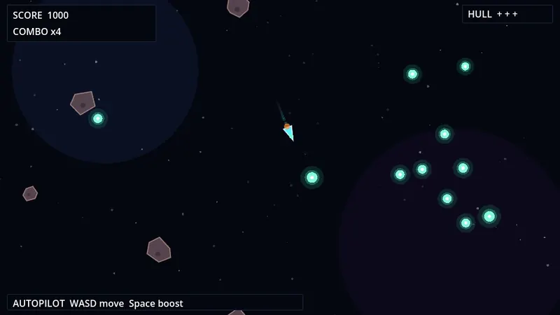
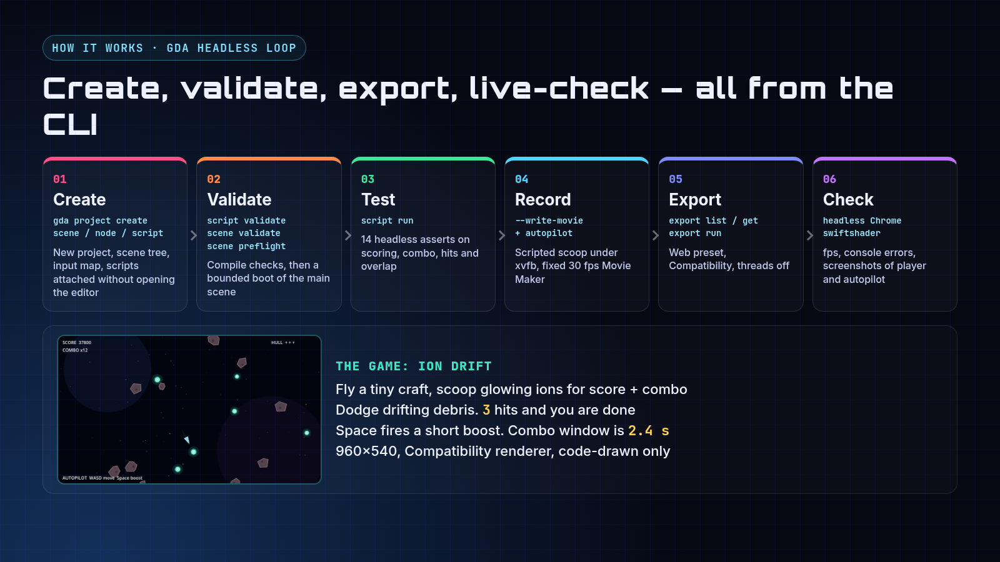
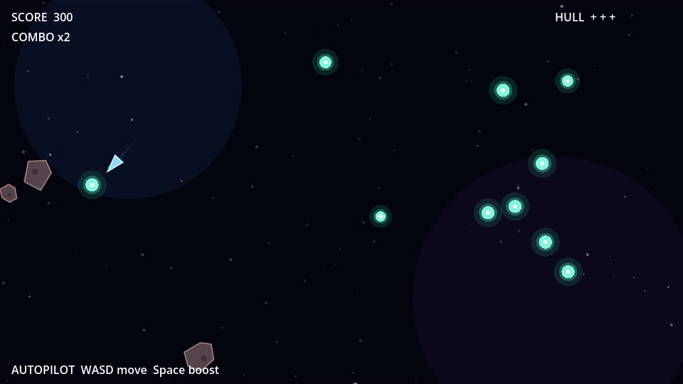
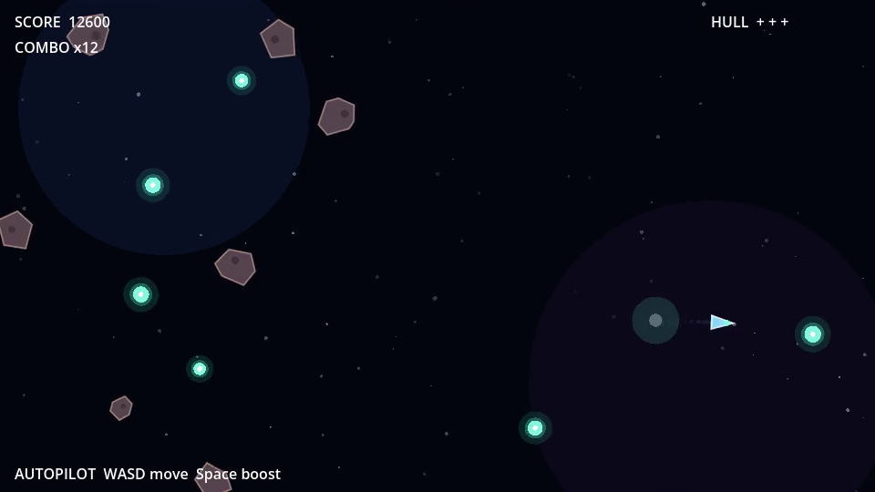
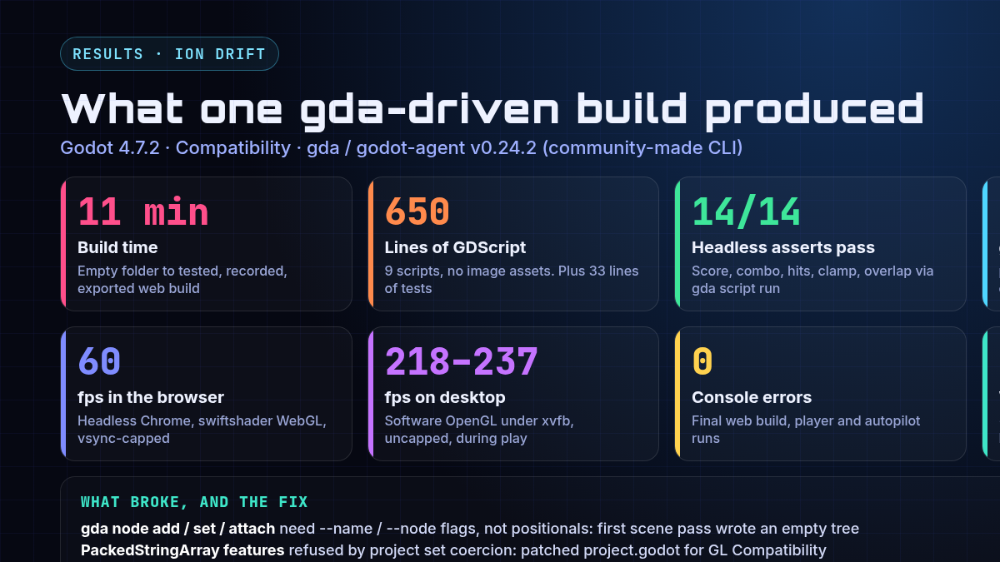

# Ion Drift



Full-quality video: [media/gameplay.mp4](media/gameplay.mp4)

Ion Drift is a tiny 2D top-down arcade scoop. Fly a craft with WASD or arrows, scoop glowing ions for score and combo, dodge drifting debris rocks. Space fires a short boost. Three hits and you are done. Built in Godot 4.7.2 with the Compatibility renderer so it also runs in a browser. Craft, ions, rocks, trail and bursts are all drawn in code — no image assets.

## Features

- Scoop-and-combo scoring up to x12, with a short Space boost
- Keyboard and gamepad bindings in the Input Map (WASD/arrows, Space boost, R restart)
- Code-drawn craft, ions, debris and FX on the Compatibility renderer
- Seeded autopilot for repeatable recordings and web checks (`-- --autopilot` or `?autopilot=1`)



## How to run

You need [Godot 4.7.2](https://godotengine.org/download). The project uses the Compatibility renderer.

```bash
# play
godot --path .

# watch the seeded autopilot play
godot --path . -- --autopilot

# headless rule asserts
godot --headless --path . -s res://tests/test_rules.gd

# or with gda (community CLI)
gda script run res://tests/test_rules.gd

# web export (needs the Godot 4.7.2 export templates)
mkdir -p build/web && godot --headless --path . --export-release Web build/web/index.html
```

A ready-made web build is attached to the GitHub Release as `ion-drift-web.zip`. Serve the unzipped folder over HTTP to play it. Add `?autopilot=1` to the URL to watch the autopilot.

## Tech notes

These are the numbers measured when the game was built:

- 650 lines of GDScript across 9 scripts, plus 33 lines of tests. The game data in the web build is 32 KB (`.pck`).
- 14/14 headless asserts pass on scoring, combo, hits, clamp and overlap.
- fps: 60.2 in headless Chrome on software WebGL (vsync-capped). 218 to 237 uncapped on desktop under xvfb with software OpenGL.
- 0 console errors in the final web build, in both player and autopilot runs.
- Autopilot Movie Maker run: 32.03 s at fixed 30 fps, scored 64,200 with 59 scoops, combo x12, 0 hits (seed 11). The highlight clip is a 28 s trim of that recording.
- Built with the community-made [gda](https://github.com/aigengame/godot-agent) CLI (v0.24.2): project create, scene/node/script, validate, preflight, script run, export run. 136 gda commands logged for this build.

| Scoop | Combo | Results |
|---|---|---|
|  |  |  |

Gameplay video: [media/gameplay.mp4](media/gameplay.mp4).

## Credits

- Built with [gda / godot-agent](https://github.com/aigengame/godot-agent) by aigengame. It is **community-made, not an official Godot project**. Godot has no official AI tooling.
- Built with the [Godot Engine](https://godotengine.org) 4.7.2.
